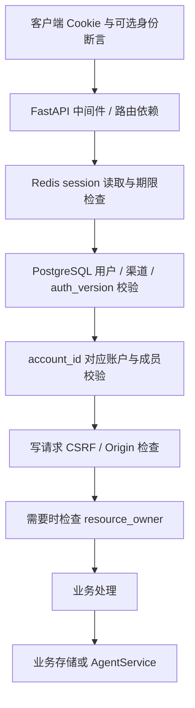

# 架构与设计思想

本文回答系统如何组成、代码放在哪里，以及当前设计解决了什么问题。具体表结构见 [数据模型](data-schema.md)，业务时序与失败行为见 [业务流程](business-flows.md)。

## 1. 这个服务负责什么？

`api/` 是基于 FastAPI 的 Python 服务，提供用户登录、个人资料与登录方式管理、会话 CRUD 与消息创建/查询、Agent 会话及 turn 执行，并提供配置、追踪和缓存教学接口。

它与 `web/` 前端配合使用，但不负责前端渲染。仓库中的 `api-rs/` 是另一套实现，不是 Python 服务运行时的一层。

当前运行边界：

| 组件 | 职责 | 与本服务的关系 |
| --- | --- | --- |
| 浏览器 / Web | 展示界面、携带 Cookie 和 CSRF token | HTTP 客户端，不决定可信用户或账户 |
| FastAPI | 路由、参数校验、请求依赖、响应及 SSE | 应用入口 |
| PostgreSQL | 用户、账户、成员、凭据、资源归属及所选业务存储 | 认证与授权的持久事实来源 |
| Redis | 登录 session、一次性 OAuth state、密码限流及缓存 | 登录运行依赖 |
| Google / 钉钉 | 外部身份验证 | 通过 provider 适配，不能直接替代本地用户 |
| LLM / Agent SDK | 模型与工具执行 | 通过 backend 协议接入 AgentService |
| 本地目录 / 对象存储 | 文件读写、工具输出 | 与数据库分开管理；不是自动受 account 隔离的统一文件仓库 |
| OTel collector | 接收配置启用的遥测 | 可观测性出口，不参与授权判断 |

实现入口：[main.py](../src/api/main.py)、[路由注册](../src/api/routes/__init__.py)、[lifespan](../src/api/core/lifespan.py)。

## 2. 为什么沿用技术分层？

account/auth 涉及路由、输入输出、持久化、外部身份验证和会话安全。按照技术职责分布文件，可以在同一层比较不同业务，也便于定位一次改动需要影响哪些环节。

因此，账户与认证不再整体放入一个独立的业务目录。业务关系由明确的类型、调用、测试和本文档表达。

| 位置 | 放什么 | 新增代码时应避免什么 |
| --- | --- | --- |
| [`routes/`](../src/api/routes/) | HTTP 方法与路径、请求响应、依赖组合、错误转换、SSE | 把复杂事务或供应商 SDK 细节继续堆到 handler |
| [`schemas/`](../src/api/schemas/) | 公共请求响应类型、校验、OAuth attempt 等内部契约 | 直接把 ORM 对象或密码哈希暴露给客户端 |
| [`models/`](../src/api/models/) | SQLAlchemy ORM、字段、外键、索引与约束 | 用 Pydantic 请求模型代替持久结构 |
| [`repositories/`](../src/api/repositories/) | 查询、写入、事务、锁与存储一致性 | 由客户端身份字段直接决定归属 |
| [`services/`](../src/api/services/) | OAuth provider 适配与账户 OAuth 编排 | 依赖路由模块中的共享函数 |
| [`dependencies/`](../src/api/dependencies/) | 请求用户解析、资源授权、仓库注入、共享限流 | 把 Header API Key 当成浏览器用户登录 |
| [`core/`](../src/api/core/) | 配置、数据库、Redis、session、安全工具、请求上下文与日志 | 在每个路由创建自己的连接池或会话中间件 |
| [`cli/`](../src/api/cli/) | 管理命令与交互输入 | 将密码作为命令行参数或写入日志 |
| [`tools/`](../src/api/tools/) / [`utils/`](../src/api/utils/) | 已有工具实现与通用适配 | 把存在的 Python 函数等同于已公开 HTTP 功能 |

现有依赖入口有三处：根 [`deps.py`](../src/api/deps.py) 提供 `SettingsDep` / `PostgresDep`，`dependencies/` 提供业务请求依赖，[`core/deps.py`](../src/api/core/deps.py) 保留统一用户/Header 认证入口及兼容别名。新增代码应复用适用入口，不再复制一套身份解析。

### 当前并非所有模块都已完成同一种分层

- [`routes/conversations.py`](../src/api/routes/conversations.py) 仍包含内存字典和数据库操作。新增复杂能力时可逐步提取仓库，不应把它描述为已经独立的 service/repository 链。
- [`agents/`](../src/api/agents/) 保留 `contracts → service → backend/store` 的既有组织。此次账户重构没有搬迁整套 Agent 模块。
- [`services/account_oauth.py`](../src/api/services/account_oauth.py) 是请求流程编排，仍接收 FastAPI / Redis session 依赖，并非完全与传输层无关的纯领域服务。
- `repositories/user_security.py` 处理用户资料与凭据的事务，当前类名仍为 `AccountStore`；`repositories/account.py` 的 `AccountRepository` 才负责资源空间。
- 密码散列工具目前与 `PasswordRepository` 同处一个模块。不能仅凭目录名推断已经严格遵守单向依赖。

这些是阅读代码时需要知道的现状。分层约定帮助后续改动收敛，但目前没有架构测试强制禁止所有跨层调用。

## 3. 应用如何组装和管理生命周期？

[`create_app()`](../src/api/main.py) 是 HTTP 组装入口：

1. 把项目 `Settings` 传入 Redis SDK 配置。部分 SDK 装饰器在路由导入时就读取配置，因此不能全部推迟到 startup。
2. 创建 FastAPI，关闭其原生自动 telemetry 路径，由项目统一配置埋点。
3. 安装缓存支持、受控示例、单个认证 session 中间件及请求上下文中间件。
4. 挂载 `/api` 路由、`/api/files` 静态目录、健康检查和 hello。
5. 配置 OTel 与统一日志。

应用 lifespan 再次同步 Redis 配置并进入 SDK 的 `redis_lifespan`。关闭时依次结束已创建的 AgentService、释放数据库 engine；SDK 自己管理 Redis 资源退出。

数据库 engine / `AsyncSessionLocal` 在 [`core/db.py`](../src/api/core/db.py) 统一定义。仓库通常通过 `sessions.begin()` 管理事务；根 `get_db()` 只负责创建和关闭 session，不自动替所有路由提交事务。

AgentService 在需要时由运行时工厂组装并挂在 `app.state`，而不是每个请求新建一整套 backend。配置缓存与 SDK 配置在进程中共享，修改配置后需要重启。详见 [配置参考](configuration.md)。

## 4. 一个受保护请求如何到达业务资源？

这是逻辑校验顺序示意，不表示每一个公开端点都经过所有节点。具体依赖见 [`dependencies/auth.py`](../src/api/dependencies/auth.py)。

关键边界：

- Cookie 持有随机 session ID；服务端 session 保存本地 `user_id` 与当前 `account_id`。第三方 token 不作为本站 session 内容。
- `AuthUser` 是已经验证的请求上下文，不是客户端可自由提交的用户资料。
- `User-ID`、`Tenant-ID`、`Account-ID` 请求头是可选一致性断言。它们不能替代登录，也不能切换空间。
- 登录用户、账户、成员或渠道失效时，请求不能继续以旧身份访问资源。
- conversation 与 agent session 的资源归属需要同时符合账户和用户；workspace 成员关系本身不授予读取其他成员私人资源的权限。

### 不是所有入口都使用同一认证策略

| 入口 | 当前边界 |
| --- | --- |
| `/api/auth/*` | 包含匿名登录入口与 session/logout；各操作有自己的策略 |
| `/api/account` 与其子路由 | 已登录用户，写操作要求 CSRF，安全变更还要求近期验证 |
| `/api/conversations`、`/api/agents` | 用户 session 与相关资源归属 |
| Header 认证教学接口 | 独立服务密钥，限定 dev/local，不建立用户 session |
| 其他 examples | 按路径、环境及是否访问会话数据执行检查 |
| `/api/config` | 非 prod 才挂载，要求登录；不等同于管理员管理接口 |
| `/api/health`、`/api/hello` | 公开端点；health 检查 Redis 与 PostgreSQL |
| `/api/files` | 直接挂载静态目录，没有同样的 `resource_owner` 下载鉴权 |
| `/docs`、`/redoc` | prod 关闭 UI；当前代码没有同时关闭默认 `/openapi.json` |

文件公开范围是实际系统边界，不应将私有数据放入该目录后假定账户规则会自动保护它。具体端点以 [接口参考](api-reference.md) 为准。

## 5. 为什么把 User 与 Account 分开？

`User` 回答“哪个人正在操作”，`Account` 回答“资源处于哪个空间”，`UserIdentity` / `PasswordCredential` 回答“如何证明这个人是谁”。

新用户默认创建个人账户和 owner 成员关系。workspace 继续使用同一套账户模型，通过成员关系支持多人；不必把登录用户改造成组织，也不必让个人用户走没有账户 ID 的例外路径。

`structure` 只有 `personal` 与 `workspace`，不是订阅套餐、供应商类型或角色。当前没有计费、席位和套餐能力，不能从该字段推断这些功能已经实现。

完整约束和删除语义见 [数据模型](data-schema.md)，选择理由见 [ADR 0001](decisions/0001-user-account.md)。

## 6. 哪些一致性由什么机制保障？

| 范围 | 当前机制 | 不能保证的事情 |
| --- | --- | --- |
| 新用户、身份、个人账户与成员 | 一个数据库事务 | 不替代后续 Redis session 写入成功 |
| 凭据变更 | User 行锁、凭据锁及 `auth_version` | 不提供外部 OAuth 与本地数据库的分布式事务 |
| 身份、用户名全局占用 | 数据库唯一约束 | 相同邮箱不会自动链接用户 |
| 资源创建与归属 | 创建后由服务端写 owner 映射，读取时先验证归属 | 两次写入不是统一事务，失败可能留下不可访问孤立资源 |
| Agent 同 session 并发 turn | store 原子 claim、lease、完成时 active-turn 比较 | 不提供工具外部副作用的 exactly-once 保证 |
| PostgreSQL 与 Redis | 明确失败返回，旧认证版本失效 | 数据库提交后 Redis 失败不会自动撤销数据库操作 |

这些约束决定了客户端何时可以重试、运维如何排错。详细场景见 [业务流程](business-flows.md) 和 [操作手册](operations.md)。

## 7. 如何理解 Agent 的扩展边界？

[`AgentService`](../src/api/agents/service.py) 负责 session/turn 编排，不直接依赖 FastAPI 和供应商 SDK；[`contracts.py`](../src/api/agents/contracts.py) 定义应用自己的执行与存储协议；[`runtime.py`](../src/api/agents/runtime.py) 根据配置选择实现。

backend 负责验证工具与模型配置、执行、把 SDK 事件转换成应用事件并产出继续执行的状态。store 负责 session、turn、lease 和完成状态持久化。HTTP 路由负责授权与 JSON/SSE 传输。

当前不是后台任务队列：执行与请求内协程相关，lease 用于互斥和过期恢复，不会自动重跑模型或重放工具。配置选择内存业务存储时，进程重启会丢失这些业务记录，但用户认证和资源归属依旧依赖 PostgreSQL。

## 8. 修改架构时应继续回答的问题

- 新能力是否真的需要新目录，还是适合现有技术层？
- 有没有把请求生命周期、数据库事务与外部执行混为一件事？
- 对外合同是否泄漏了数据库列或 SDK 的内部对象？
- 新存储能否提供业务所需的原子性，而不只是实现同名方法？
- 新增公开路由、静态挂载或示例时，是否明确其认证策略？
- 业务完成、数据持久化和响应成功的判据是否一致？

主要验证依据：[认证路由测试](../tests/test_auth_routes.py)、[资源授权测试](../tests/test_auth_ownership.py)、[账户安全测试](../tests/test_account_routes.py)、[Agent service 测试](../tests/test_agent_runtime.py)、[Agent store 测试](../tests/test_agent_store.py)。
